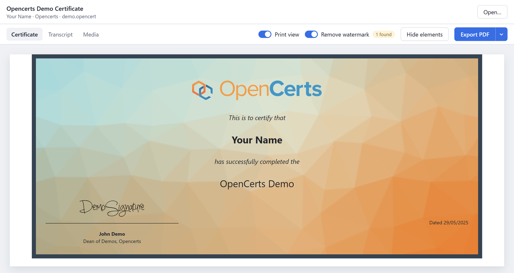
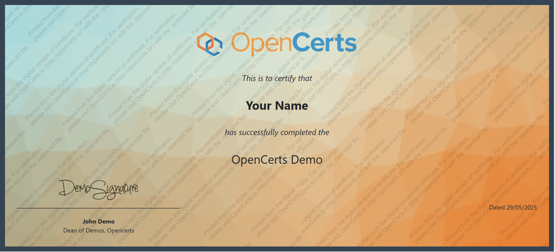
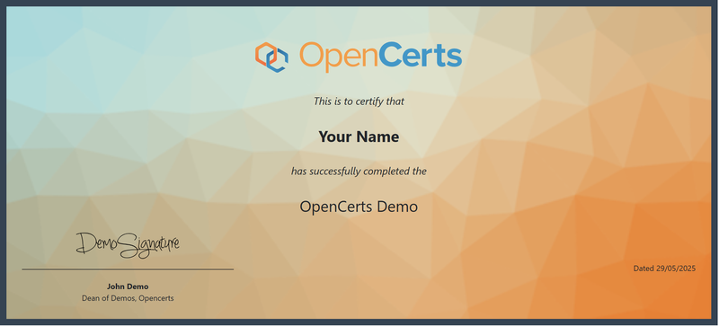
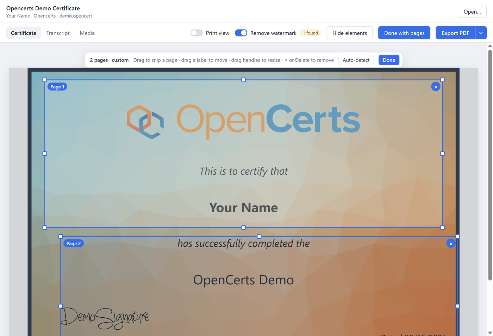
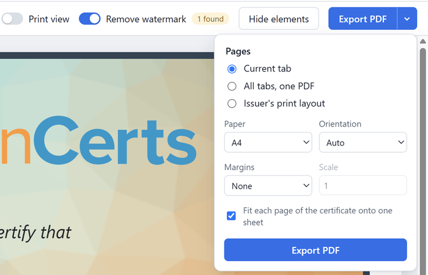

# OpenCert Watermark Remover

A desktop app for viewing [OpenCerts](https://opencerts.io) (`.opencert`) files and exporting them to a clean, full-resolution PDF.

Employers often ask for certificates as PDFs. Printing an OpenCert from the browser tends to go wrong in two ways:

- **Watermarks.** Many issuers' renderers add a "printed from the digital version" watermark that only shows up when printing.
- **Layout and resolution mismatch.** Certificates are designed for the screen, so printed pages get re-flowed, squeezed or split across sheets, and screenshots lose sharpness.

This app renders the certificate with the **issuer's own renderer** (exactly as opencerts.io does), then exports it through Chromium's vector PDF engine. Text stays selectable and sharp, images keep their original resolution, and every designed page (certificate, each transcript page, ...) lands on its own sheet.



*Screenshots use the public [OpenCerts demo certificate](https://github.com/OpenCerts/opencerts-website/tree/master/public/static/demo), not a real person's certificate.*

## Download

Grab the latest build from the [Releases](../../releases) page:

- **`OpenCert Watermark Remover-Setup-<version>.exe`**: Windows installer (adds a Start menu entry and lets you open `.opencert` files by double-clicking)
- **`OpenCert Watermark Remover-Portable-<version>.exe`**: single exe, nothing to install

The builds are not code-signed, so Windows SmartScreen may warn on first launch ("More info" → "Run anyway").

## Removing the watermark

Many issuers' renderers add a watermark that only appears when the certificate is printed. Turn on **Print view** to see the certificate the way it prints, and **Remove watermark** to strip it. The badge shows how many watermark layers were found.

| Print view, watermark kept | Print view, watermark removed |
| --- | --- |
|  |  |

With **Print view** off (the default), the PDF uses the certificate's on-screen look, as on opencerts.io. Print-only watermarks never appear in that mode.

## Splitting into pages

Many certificates have tabs that are really several pages (a transcript, explanatory notes, a skills record). The app splits each tab into PDF pages automatically:

- **Designed pages** (page breaks, or a stack of page-shaped cards) each become one page.
- Anything else is **trimmed to its content**, so no wasted margins.
- A page much taller than the sheet is **split only in whitespace** between text lines, images and table rows, never through text.

Click **Pages** to see the boxes and adjust them like a snipping tool:

- **Drag** anywhere to snip a new page (also inside an existing box)
- **Drag a label** ("Page 1") to move a box, **drag the handles** to resize it
- **×** or **Delete** removes a page; **Auto-detect** brings back the automatic boxes

Every box becomes its own sheet, in reading order, scaled to fit and centred. Boxes are kept per tab, so you can lay out each tab differently before exporting **All tabs, one PDF**.



## Export options



## Features

- Opens OpenAttestation v2/v3 and W3C VC OpenCerts (drag & drop or **Open…**)
- Template tabs (Certificate / Transcript / ...) like opencerts.io
- **Remove watermark**: detects watermark layers in the renderer (CSS rules or images referencing a watermark) and removes them
- **Hide elements**: click any part of the certificate to hide it from the export
- **Print view**: preview and export with the issuer's print styles instead of the on-screen look
- **Export PDF**: current tab, all tabs merged into one PDF, or the issuer's print layout; A4/Letter/A3/A5/Legal/Tabloid; auto/portrait/landscape; optional margins
- **Smart page splitting**: designed pages, content trimming, and whitespace-aware splitting of tall pages
- **Pages editor**: snipping-tool style boxes to choose exactly what goes on each PDF page
- Headless command-line export

## Running from source

```sh
npm install
npm start
```

To try it without a certificate of your own, download [`sepolia.opencert`](https://github.com/OpenCerts/opencerts-website/blob/master/public/static/demo/sepolia.opencert) from the OpenCerts demo files and open it.

If you run from a VS Code terminal and Electron behaves like plain Node, unset `ELECTRON_RUN_AS_NODE` first.

### Command line

```sh
npm run export -- path/to/cert.opencert [out.pdf] [options]
```

| Option | Meaning |
| --- | --- |
| `--all` | Export all tabs into one PDF |
| `--print-styles` | Use the issuer's print layout instead of the on-screen look |
| `--keep-watermark` | Don't remove watermarks |
| `--page A4\|Letter\|A3\|A5\|Legal\|Tabloid` | Sheet size (default A4) |
| `--landscape` / `--portrait` | Force orientation (default: matches each page) |
| `--margins none\|default` | Sheet margins (default none) |
| `--no-fit` / `--scale <n>` | Skip page detection; let the browser paginate at a fixed scale |

### Building the Windows exe

```sh
npm run dist
```

This writes the installer and the portable exe to `release/`.

## How it works

1. The `.opencert` is parsed (OA v2 salted values are unwrapped) and its renderer URL is read from `$template.url` (or the legacy OpenCerts renderer).
2. The renderer is loaded in an iframe and driven over the same penpal postMessage protocol opencerts.io uses (v4 and v6 handshakes, plus the legacy method API).
3. Some issuers only allow opencerts.io to frame their renderer (`frame-ancestors`). The app lifts that header for its own viewer frame, locally.
4. On export, a static snapshot of the rendered DOM is taken. CSS-in-JS rules, canvases and blob images are inlined, and watermark and hidden elements are removed. The snapshot is served at the renderer's own origin in a throwaway session, so fonts and images load exactly as before.
5. The snapshot is laid out at exactly the width you were viewing and printed as one tall vector page.
6. Each page box (detected or drawn by you) is clipped out of that page and placed on its own sheet as a vector form using [pdf-lib](https://pdf-lib.js.org), so text stays selectable and images keep full resolution.

## Notes

- An internet connection is needed: the certificate is drawn by the issuer's renderer.
- This app does not verify certificates. The PDF is a convenience copy; the `.opencert` file remains the verifiable original, and recipients can check it at opencerts.io.
- Only use this on certificates that belong to you.

## Project layout

```
src/main/main.js           Electron main process, IPC, CLI
src/main/frame-helpers.js  Code injected into the renderer frame (watermark detection, pick mode, snapshot)
src/main/pdf-export.js     Snapshot -> PDF pipeline (tall vector page -> clipped page regions -> sheets)
src/main/page-detect.js    Automatic page detection and whitespace-aware splitting
src/renderer/page-editor.js  Snipping-tool style page editor
src/main/preload.js        Bridge exposed to the viewer UI
src/shared/opencert.js     .opencert parsing
src/renderer/              Viewer UI (bundled with esbuild into dist/)
```
